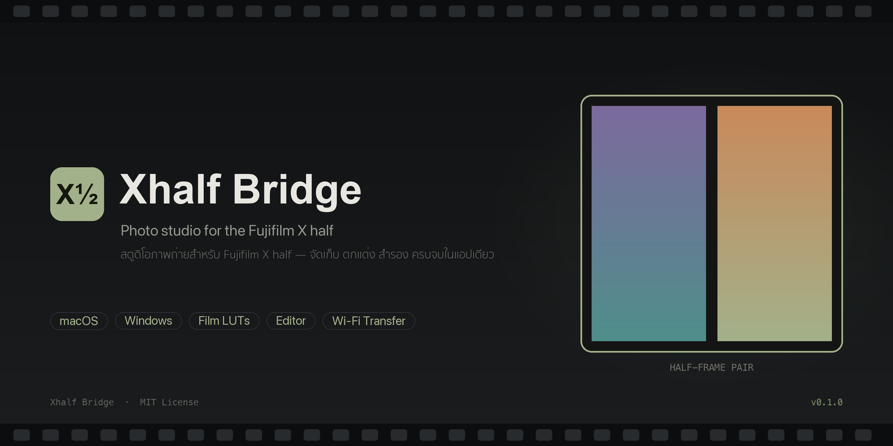

<div align="center">



# Xhalf Bridge

**สตูดิโอภาพถ่ายบนเดสก์ท็อปสำหรับ Fujifilm X half — จัดเก็บ ตกแต่ง สำรอง รับไร้สาย ครบจบในแอปเดียว**

[English](README.md) | [ไทย](README.th.md)


**[⬇️ ดาวน์โหลดรีลีสล่าสุด](https://github.com/bvnkfatboy/xhalf-bridge/releases/latest)**

</div>

---

Xhalf Bridge คือ Desktop Application สำหรับ macOS และ Windows ที่รวมทุกอย่างที่ผู้ใช้ Fujifilm X half ต้องการไว้ในที่เดียว ทำงานออฟไลน์ทั้งหมด: นำเข้าภาพจากการ์ด SD หรือมือถือ จัดอัลบั้มและม้วนฟิล์มดิจิทัล ตกแต่งภาพด้วยฟิล์ม LUT เกรน และพรีเซ็ต ต่อภาพคู่แบบ Half Frame ทำคอนแทกต์ชีต สำรองข้อมูลแบบตรวจสอบ hash และรับภาพจากมือถือผ่าน Wi-Fi ในเครือข่ายเดียวกัน **โดยไม่ต้องติดตั้งแอปมือถือเพิ่ม**

## ✨ ฟีเจอร์เด่น

### 📷 คลังภาพ
- นำเข้า JPEG/PNG จากโฟลเดอร์ ฮาร์ดดิสก์ภายนอก หรือ drag & drop — คัดลอกเข้าคลัง (ไฟล์ต้นฉบับไม่ถูกแตะ) ตรวจ **SHA-256** และข้ามไฟล์ซ้ำอัตโนมัติ
- กริดปรับขนาดได้, Lightbox เต็มจอ, เรียงตามวันที่ถ่าย/วันนำเข้า/ชื่อ/ขนาด, กรองช่วงวันที่, ค้นหา
- อ่าน EXIF ครบ: วันที่ถ่าย กล้อง ช่องรับแสง/ชัตเตอร์/ISO/เลนส์ — ถ้าไม่มี EXIF จะใช้วันที่นำเข้าและ**แสดงที่มาของวันที่ให้ชัดเจน**
- Favorites, โน้ตรายภาพ, เปิดตำแหน่งไฟล์, ส่งออกสำเนาทุกรูปแบบ

### 🎨 หน้าตกแต่งภาพ (Editor)
- **แสง:** แสงรวม, คอนทราสต์, ไฮไลต์, เงา, สีขาว, สีดำ
- **สี:** อุณหภูมิสี, โทนสี, ความอิ่มสี, ความสดใส
- **รายละเอียด:** ความคมชัด, ความชัดโครงสร้าง, **ลดนอยส์/ลดเกรน**
- **ลุคฟิล์ม:** **เกรนฟิล์ม** (ปรับปริมาณ + ขนาด), ขอบมืด, ซีดจาง
- **ฟิล์ม LUT ในตัว 40 แบบ** จากชุด G'MIC — Portra, Ektar, Kodachrome, Velvia, Tri-X, Polaroid, ซิมูเลชัน Fuji X-Trans, ฟิล์มภาพยนตร์ — และ**นำเข้าไฟล์ `.cube` ของตัวเองได้**
- **พรีเซ็ตฟิล์ม 22 แบบ** พร้อมใช้ + บันทึกพรีเซ็ตของตัวเองได้
- **ปรับอัตโนมัติ:** วิเคราะห์ histogram แบบคำนวณเชิงคณิตศาสตร์ ปรับแสง-สีให้สมดุล
- บันทึกแบบ non-destructive, เทียบ before/after, pinch-to-zoom ด้วย trackpad, ส่งออก JPEG เต็มความละเอียด

### 📁 อัลบั้ม & 🎞 ม้วนฟิล์ม
- จัดกลุ่มเชิงตรรกะ — ไฟล์ไม่ถูกย้าย ลบอัลบั้มแล้วภาพยังอยู่ครบ
- ลากจัดลำดับ ภาพหน้าปก ส่งออกเป็นโฟลเดอร์หรือ ZIP
- ม้วนฟิล์มดิจิทัลพร้อมเป้าเฟรม (24/36/72) หมายเลขเฟรมอัตโนมัติและ progress bar

### 📡 รับภาพไร้สาย
1. กดเริ่มรับ → เปิดหน้าอัปโหลดใน Wi-Fi ของคุณ
2. สแกน QR Code ด้วยมือถือ
3. ส่งภาพที่บันทึกไว้จากแอป Fujifilm X half — ไฟล์เข้าคลังพร้อมตรวจ hash และสร้างรูปย่ออัตโนมัติ

ยืนยันด้วย pairing token, รับเฉพาะ JPEG/PNG, จำกัดขนาด/จำนวน, กัน path traversal, ตรวจไฟล์ซ้ำ และ**ไม่เปิดสู่อินเทอร์เน็ตสาธารณะ**

### 📋 คอนแทกต์ชีต & 🖼 ภาพคู่ Half Frame
- คอนแทกต์ชีตจากอัลบั้มหรือม้วนฟิล์ม: คอลัมน์ ขนาดรูป เลขเฟรม วันที่ ระยะขอบ สี — เรนเดอร์แบบ batch รองรับคลังใหญ่
- ภาพคู่ 7 เลย์เอาต์ ปรับซูม/ตำแหน่งรายเฟรม ขอบ เส้นแบ่ง คำบรรยาย undo/redo บันทึกโปรเจกต์ ส่งออก JPEG/PNG สูงสุด 4000 px

### 💾 สำรองข้อมูล
- คัดลอกภาพทุกไฟล์ (ตรวจ SHA-256 หลังคัดลอก) + snapshot ฐานข้อมูล + manifest ไปยังดิสก์ใดก็ได้
- เช็คพื้นที่ว่างก่อนทำงาน ตรวจสอบย้อนหลังได้ และไม่ลบสิ่งใดในปลายทาง

### 🌐 ไทย & English
ทั้งแอปรองรับสองภาษา เปลี่ยนได้ที่ **ตั้งค่า → ภาษา**

## ⬇️ ดาวน์โหลด

ดาวน์โหลดตัวติดตั้งล่าสุดจาก [**Releases**](https://github.com/bvnkfatboy/xhalf-bridge/releases/latest):

| แพลตฟอร์ม | ไฟล์ |
|---|---|
| macOS (Apple Silicon) | `Xhalf_Bridge_aarch64.dmg` |
| Windows 10/11 (x64) | `Xhalf_Bridge_x64-setup.exe` / `.msi` |

> ตัว build macOS ยังไม่ได้ sign — เปิดครั้งแรกให้คลิกขวา → **Open**
> เปิดครั้งแรกจะสร้างคลังภาพที่ `~/Pictures/Xhalf Bridge` (เปลี่ยนได้ในตั้งค่า)

## 🛠 Build จากซอร์ส

ต้องมี Rust, [Bun](https://bun.sh) (หรือ Node.js) และ Xcode CLT / MSVC Build Tools

```bash
bun install        # หรือ: npm install
bun run tauri dev  # โหมดพัฒนา
bun run test       # unit tests (Vitest)
bun run tauri build
```

Release ทั้งสองแพลตฟอร์ม build อัตโนมัติด้วย GitHub Actions เมื่อ push tag `v*` (ดู [`.github/workflows/release.yml`](.github/workflows/release.yml))

## 🧱 เทคโนโลยี

| ชั้น | เทคโนโลยี |
|---|---|
| Desktop | Tauri 2 |
| Frontend | React 18 + TypeScript + Tailwind CSS 4 |
| Backend | Rust (SQLite, axum, image, kamadak-exif, sha2) |
| ความถูกต้อง | SHA-256 ทุกขั้นตอน |
| Testing | Vitest + Rust unit tests |

```
xhalf-bridge/
├── src/            # React frontend (pages, components, i18n, WebGL editor engine)
├── src-tauri/      # Rust backend (db, importer, albums, transfer server, backup…)
├── public/luts/    # ฟิล์ม LUT ในตัว 40 แบบ (.cube)
├── docs/           # ไฟล์ประกอบ + สคริปต์สร้างภาพปก
└── tests/          # Vitest unit tests
```

## 🔒 ความเป็นส่วนตัว

ทุกอย่างประมวลผลในเครื่อง ไม่มีบัญชี ไม่มี analytics ไม่มี API key ภาพของคุณจะออกจากเครื่องเฉพาะเมื่อคุณเลือกส่งเองผ่าน**เครือข่ายท้องถิ่นของคุณ**เท่านั้น

## 🗺 Roadmap

รองรับ RAW · สำรองตามเวลา · auto-import จากโฟลเดอร์ · custom film border · เชื่อมต่อกล้องโดยตรง (ต้องทดสอบโปรโตคอล) · Windows ARM

## 📄 License

[MIT](LICENSE) — ฟิล์ม LUT ในตัวมาจาก [G'MIC Film Luts collection](https://github.com/YahiaAngelo/Film-Luts) โดย YahiaAngelo (MIT)
